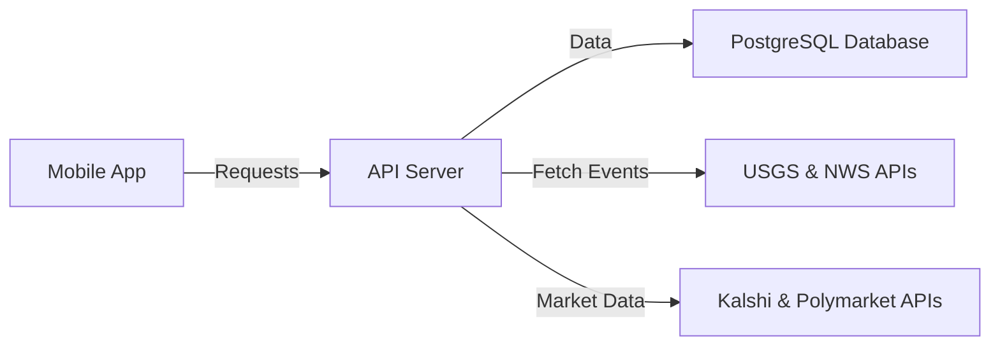

# Tremor

Real-world events become prediction markets you can trade in seconds.

Tremor is a mobile-first prediction market companion app that bridges real-time event alerts directly into the prediction market ecosystem. With seamless integration of alerts and markets, users stay ahead and make informed trades instantly.

## Features

- Real-time event feed aggregating earthquake alerts, weather emergencies, and breaking news.
- Smart market matcher for related prediction markets.
- Push notifications for subscribed event categories.

## Tech Stack

- **Frontend:** React Native (via Expo SDK 44.0.0), Redux 4.1.0
- **Backend:** Node.js 16.x, Express 4.17.1
- **Database:** PostgreSQL 13 (via Supabase)
- **Infrastructure:** Vercel or Railway, GitHub Actions, Expo Push Notifications, RevenueCat, OpenAI GPT-4o mini

## Architecture

Tremor uses a microservice architecture that efficiently connects the mobile client to event data APIs and prediction market platforms.



## Project Structure

```plaintext
tremor/
├── app/
│   ├── components/
│   │   ├── EventCard.js
│   │   ├── NotificationBanner.js
│   │   ├── PortfolioTracker.js
│   ├── screens/
│   │   ├── HomeScreen.js
│   │   ├── PortfolioScreen.js
│   ├── navigation/
│   │   ├── AppNavigator.js
│   ├── state/
│   │   ├── store.js
│   │   ├── reducers/
│   ├── styles/
│   │   ├── colors.js
│   │   ├── typography.js
│   ├── App.js
├── backend/
│   ├── controllers/
│   │   ├── eventController.js
│   │   ├── marketController.js
│   ├── routes/
│   │   ├── eventRoutes.js
│   │   ├── marketRoutes.js
│   ├── models/
│   │   ├── eventModel.js
│   │   ├── userModel.js
│   ├── services/
│   │   ├── notificationService.js
│   │   ├── matchingService.js
│   ├── app.js
│   ├── server.js
```

## Getting Started

### Prerequisites

- Node.js 16.x
- Expo CLI

### Installation

1. Clone the repository:
   ```bash
   git clone https://github.com/your-repo/tremor.git
   cd tremor
   ```

2. Install dependencies for the backend and app:
   ```bash
   cd backend && npm install
   cd ../app && npm install
   ```

### Environment Variables

Configure environment variables for the backend. Reference `.env.example` in the `backend` directory.

### Running

- Start the backend server:
  ```bash
  cd backend
  npm start
  ```

- Start the mobile app:
  ```bash
  cd app
  expo start
  ```

## Documentation

- [Product Requirements](docs/PRD.md)
- [Design Brief](docs/DESIGN.md)
- [Architecture](docs/ARCHITECTURE.md)

## License

This project is licensed under the MIT License.